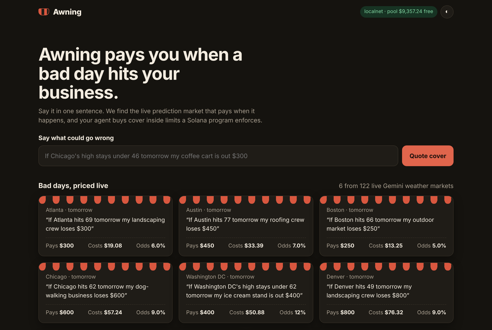
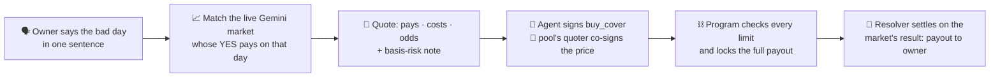
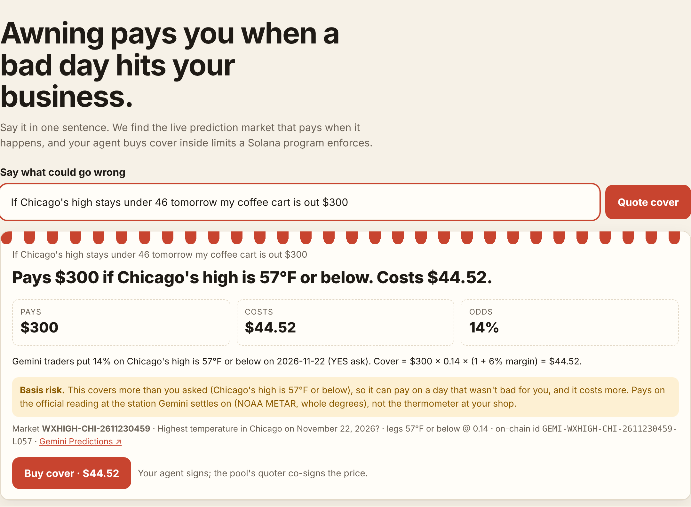
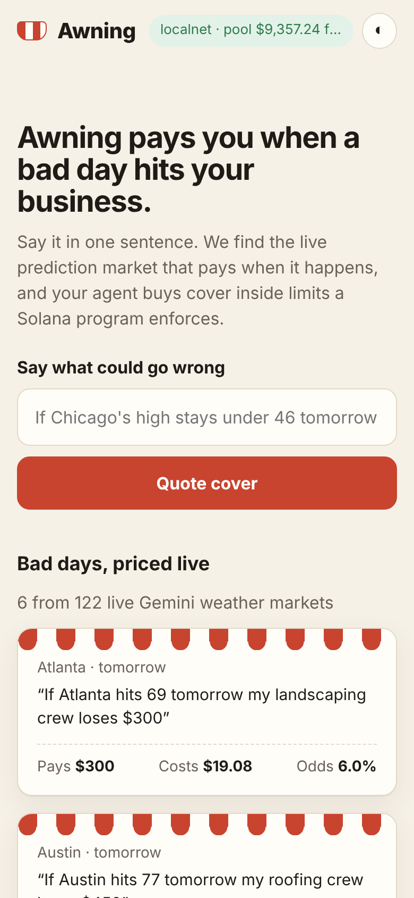
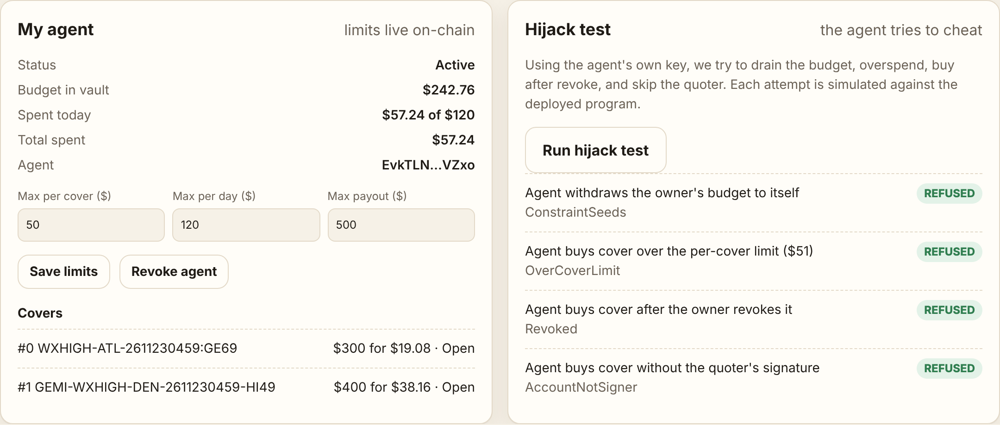
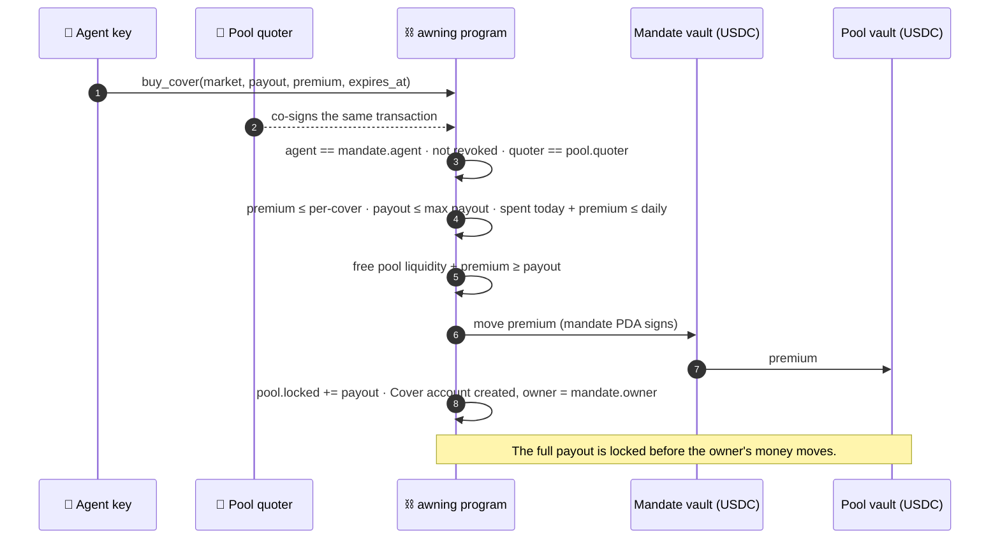
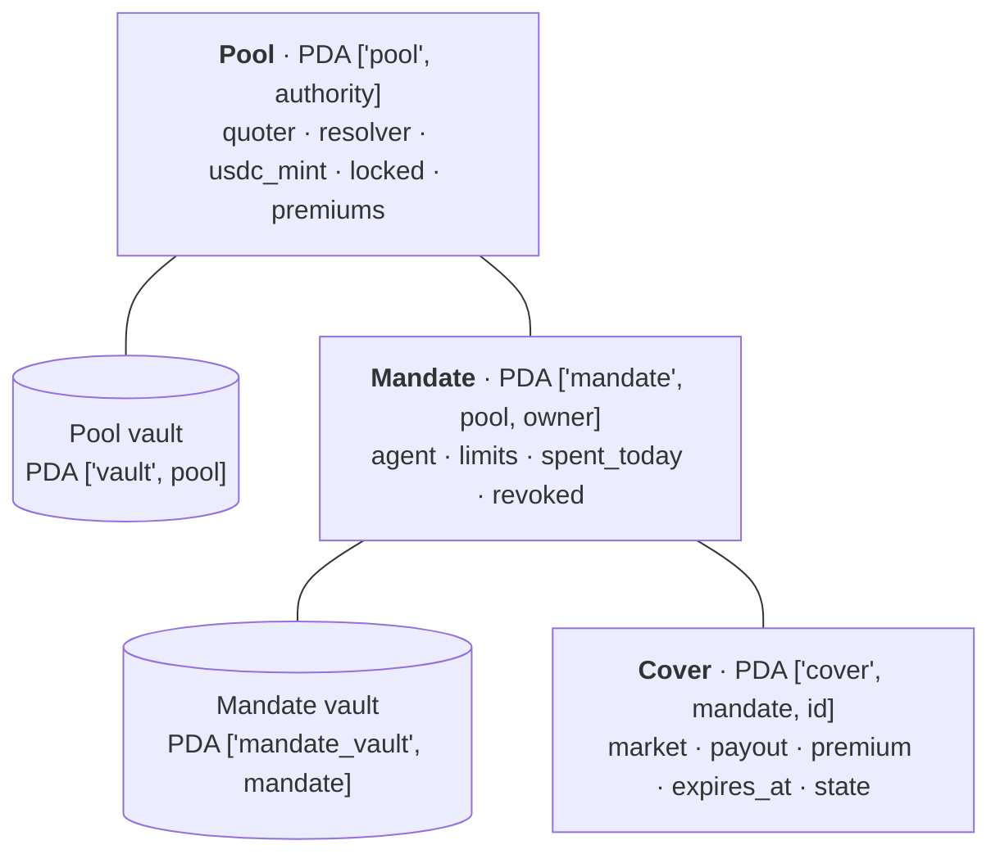

<div align="center">

# ⛱ Awning on Solana

**Say what could go wrong. Get paid when it does.**

Cover for a small business's bad days, priced from live Gemini prediction markets and bought by an AI agent whose spending limits are enforced by a Solana program, not by a prompt.


</div>

> 🏟️ **Game day**
>
> *"If Michigan loses to Villanova tonight, my Ann Arbor sports bar is out $500."*
>
> **Pays $500 if Villanova wins. Costs $212.00.**
>
> Priced from Gemini's Michigan vs Villanova market on 21 November 2026 (Villanova at 40¢ a contract), plus
> the pool's 6% margin. The app's sentence parser quotes weather days today; game days are priced the same way.



## Contents

- [Why](#why)
- [How it works](#how-it-works)
- [See it](#see-it)
- [The money is guarded by the program](#the-money-is-guarded-by-the-program)
- [The hijack test](#the-hijack-test)
- [From a sentence to a price](#from-a-sentence-to-a-price)
- [The program](#the-program)
- [Built with the Solana Developer MCP](#built-with-the-solana-developer-mcp)
- [Tests](#tests)
- [Run it locally](#run-it-locally)
- [What is real and what is not yet](#what-is-real-and-what-is-not-yet)
- [Repository layout](#repository-layout)

## Why

Small businesses carry risks nobody will insure: a cold snap that empties the patio, a heat wave that
stops the roofing crew, the home team losing on the night the bar staffed up. Prediction markets already
price exactly these days. Using them by hand means finding the right contract among hundreds, sizing it,
and understanding where the market's settlement differs from your actual loss. Almost nobody will.

Handing that job to an AI agent creates a second problem. An agent that can spend money and reads text
written by strangers will eventually be talked into something. **A spending limit written in a prompt is a
suggestion. A spending limit written in a Solana program is a rule.**

## How it works



1. **You say what could go wrong**, in plain words: *"If Chicago's high stays under 46 tomorrow my coffee cart is out $300."*
2. **Awning finds the Gemini prediction market** that pays when that day happens, and prices cover from the market's own odds.
3. **Your agent buys it** with a key that can do exactly one thing: buy cover inside the limits you set.
4. **The Solana program refuses everything else.** Over the limit, past the daily budget, without the pool's price signature, after you revoke it, or trying to move your money anywhere: refused, on-chain.
5. **When the day resolves**, the pool pays the payout straight to your token account. The agent can't redirect it.

## See it

<table>
<tr>
<td width="58%"></td>
<td width="42%"></td>
</tr>
<tr>
<td><b>A quote.</b> What the cover pays, what it costs, the market's odds, the exact formula, and where a payout could differ from your real loss.</td>
<td><b>On a phone.</b> Light and dark, from 375px up.</td>
</tr>
</table>



**My agent and the hijack test**, read from the local validator. The two covers above were bought on-chain
from live Gemini quotes: $300 of Atlanta cover for $19.08, and $400 of Denver cover for $38.16.

## The money is guarded by the program

Three keys, three jobs, and none of them can do another's:

| Key | Can | Cannot |
| --- | --- | --- |
| **Owner** | Fund the mandate, withdraw it, set limits, swap or revoke the agent | Change a price (the quoter signs prices) |
| **Agent** | Buy cover inside the limits, paid from the mandate's vault | Withdraw, raise its own limits, buy without the quoter, buy after revoke, send a payout anywhere |
| **Quoter** (the pool's pricing key) | Co-sign the price of each cover | Spend anyone's budget |
| **Resolver** | Settle a cover once the market resolves | Settle a cover twice, or pay anyone but the cover's owner |



## The hijack test

One button hands the agent's own key to an "attacker" and sends four real transactions at the deployed
program. Each comes back refused with the program's own error:

| Attempt with the agent's key | Result |
| --- | --- |
| Withdraw the owner's budget to itself | 🛑 Refused: `ConstraintSeeds` (the mandate is derived from the real owner) |
| Buy $51 of premium against a $50 per-cover limit | 🛑 Refused: `OverCoverLimit` |
| Buy after the owner revokes it | 🛑 Refused: `Revoked` |
| Buy without the pool quoter's signature | 🛑 Refused: `AccountNotSigner` |

The same cases, and more, run as integration tests against a real Solana runtime ([Tests](#tests)).

## From a sentence to a price

```
"If Chicago's high stays under 46 tomorrow my coffee cart is out $300"
   city: Chicago · day: tomorrow · direction: at or below · threshold: 46°F · payout: $300
   → Gemini "Highest temperature in Chicago on November 22, 2026?"
   → YES on the buckets that pay on that day, at their live ask
   → cost = payout × odds × (1 + 6% margin)
```

- **Live markets.** Every quote reads Gemini's public prediction-market API (`/v1/prediction-markets/events`), with retries, a 30-second cache, and the last good answer if Gemini goes quiet.
- **Several buckets.** When your day spans more than one of Gemini's temperature buckets, the cover buys YES on each and the price is the sum of their asks.
- **Honest refusals.** No live ask on a bucket → *"no honest price"*. Cover that would cost more than it pays → refused.
- **Basis risk, said out loud.** Every quote says where the payout can differ from your loss: Gemini settles on the official NOAA station reading, not the thermometer at your shop, and when Gemini's buckets don't line up with your threshold, the quote says which temperatures hurt you but don't pay, or pay when they didn't hurt.

On the day these screenshots were taken there were 122 live Gemini weather markets: daily highs for about
50 US cities in °F and 11 international ones in °C.

## The program

[`programs/awning/src/lib.rs`](programs/awning/src/lib.rs) · Anchor 0.31.1 · full contract in [`SPEC.md`](SPEC.md) · IDL in [`idl/awning.json`](idl/awning.json)



| Instruction | Signed by | What it does |
| --- | --- | --- |
| `init_pool(quoter, resolver)` | pool authority | Creates the pool and its USDC vault |
| `fund_pool(amount)` | anyone | Adds liquidity to the pool |
| `withdraw_pool(amount)` | pool authority | Takes out free liquidity only, never what is locked for open covers |
| `open_mandate(agent, limits)` | owner | Creates the owner's mandate and vault, names the agent, sets limits |
| `deposit(amount)` / `withdraw(amount)` | owner | Moves budget in and out. Only the owner, ever |
| `set_limits(limits)` | owner | Per-cover premium, per-day premium, per-cover payout |
| `set_agent(agent)` / `revoke()` | owner | Swap the agent (and un-revoke), or stop it cold |
| `buy_cover(market, payout, premium, expires_at)` | agent **and** quoter | Checks every limit, moves the premium, locks the payout, opens a Cover |
| `settle_cover(happened)` | resolver | Pays the owner if the day happened, releases the lock either way |

<details>
<summary><b>Program errors</b> (6000–6014)</summary>

| Code | Error | Meaning |
| --- | --- | --- |
| 6000 | `NotAgent` | Signer is not the mandate's agent |
| 6001 | `Revoked` | Mandate is revoked |
| 6002 | `BadQuoter` | Quoter does not match the pool's quoter |
| 6003 | `BadPrice` | Premium must be above 0 and below the payout |
| 6004 | `OverCoverLimit` | Premium exceeds the per-cover limit |
| 6005 | `OverPayoutLimit` | Payout exceeds the per-cover payout limit |
| 6006 | `OverDailyLimit` | Premium exceeds what is left of today's budget |
| 6007 | `Expired` | Cover expiry is in the past |
| 6008 | `PoolTooThin` | The pool can't lock this payout |
| 6009 | `NotOpen` | Cover was already settled |
| 6010 | `InsufficientFree` | Withdrawal would touch locked liquidity |
| 6011 | `MarketTooLong` | Market id over 48 bytes |
| 6012 | `WrongPool` | Account belongs to a different pool |
| 6013 | `WrongOwner` | Account belongs to a different owner |
| 6014 | `MathOverflow` | Checked arithmetic overflowed |

</details>

Every relationship is checked (`has_one` on owner, agent, quoter, resolver and pool), every PDA's seeds and
bump are stored and verified, token accounts are checked for mint and authority, and all arithmetic is checked.

## Built with the Solana Developer MCP

The program was written with the [Solana Developer MCP](https://mcp.solana.com) open beside it, through a
tiny client in [`tools/solana-mcp.mjs`](tools/solana-mcp.mjs):

```bash
node tools/solana-mcp.mjs --list
node tools/solana-mcp.mjs Solana_Expert__Ask_For_Help '{"question":"How do I sign a CPI with a PDA in Anchor 0.31?"}'
node tools/solana-mcp.mjs program_autofixer '{"code": "<lib.rs contents>"}'
```

Its `program_autofixer` security linter ran on the program and reported **0 issues** on the first pass.
The run is recorded in [`programs/awning/AUDIT.md`](programs/awning/AUDIT.md).

## Tests

**11 program tests** in [`programs/awning/tests/awning.rs`](programs/awning/tests/awning.rs). Each one sends
real transactions through `solana-program-test`, with the real SPL Token program.

| Test | Proves |
| --- | --- |
| `init_pool_and_fund_pool` | The pool and vault are created and funded |
| `open_mandate_and_deposit` | The owner's mandate and vault hold the budget |
| `buy_cover_happy_path` | Premium moves, the payout is locked, the Cover is written exactly |
| `over_per_cover_limit` | `OverCoverLimit` |
| `over_daily_limit` | `OverDailyLimit` |
| `buy_requires_the_pool_quoter` | No quoter signature → refused, wrong quoter → `BadQuoter` |
| `hijacked_agent_cannot_drain_or_buy_after_revoke` | The agent can't withdraw, a stranger gets `NotAgent`, after revoke `Revoked`, the owner can still withdraw |
| `pool_too_thin` | `PoolTooThin` |
| `settle_happened_pays_owner_and_unlocks` | The owner is paid, the lock is released, settling twice is `NotOpen` |
| `settle_by_non_resolver_refused` | Only the resolver can settle |
| `withdraw_pool_cannot_touch_locked` | `InsufficientFree`, and exactly the free amount works |

**13 app tests** in [`app/test/core.test.ts`](app/test/core.test.ts): the sentence parser, Gemini bucket
parsing, pricing, and the program encoders (discriminators, Borsh layout of `buy_cover`, PDA seeds).

```bash
cargo test -p awning          # program
cd app && npm test            # app
```

## Run it locally

You need the [Solana CLI (Agave)](https://docs.anza.xyz/cli/install), Rust, and Node 22.

```bash
# 1. A local chain
solana-test-validator --reset

# 2. Your own program id (keypairs are never committed)
solana-keygen new --no-bip39-passphrase -o programs/awning/keypair.json
solana address -k programs/awning/keypair.json
#    put that address in declare_id!() in programs/awning/src/lib.rs, in Anchor.toml and in idl/awning.json

# 3. Build, test and deploy the program
cargo build-sbf --manifest-path programs/awning/Cargo.toml
cargo test -p awning
solana airdrop 10
solana program deploy target/deploy/awning.so --program-id programs/awning/keypair.json

# 4. The app
cd app
npm install
npm run setup:localnet    # mock USDC, a $10,000 pool, a demo mandate: $50/cover, $120/day, $500 max payout
npm run dev               # http://localhost:3000
```

| Variable | Default | Meaning |
| --- | --- | --- |
| `SOLANA_RPC_URL` | `http://127.0.0.1:8899` | Cluster the app talks to |
| `AWNING_PROGRAM_ID` | `declare_id!` in `lib.rs` | Program to use |
| `AWNING_POOL_AUTHORITY` | `app/.keys/authority.json` | Pool to quote against |

If the program isn't deployed on the cluster, the app says so in a banner, keeps quoting from Gemini, and
turns off buying. It never fakes a chain result.

## What is real and what is not yet

| | |
| --- | --- |
| ✅ **Real** | The Anchor program, its limits and its errors, deployed and exercised on a local validator |
| ✅ **Real** | Live Gemini prediction-market prices on every quote |
| ✅ **Real** | Cover bought on-chain from those quotes, and the hijack test's refusals coming from the program |
| 🧪 **Demo shortcut** | The owner, agent and quoter keys are held by the app's server, so one person can try it end to end |
| 🧪 **Demo shortcut** | USDC is a mock mint on localnet |
| 🚧 **Not yet** | Game, fuel and crypto sentences: the parser reads weather highs today, and the game-day quote at the top is priced by hand from Gemini's market using the same formula |
| 🚧 **Not yet** | Settlement from the app: `settle_cover` is in the program and tested, but nothing runs the resolver automatically yet |
| 🚧 **Not yet** | Hedging the pool's risk back on Gemini, and devnet or mainnet deployment |

The hijack test's "buy after revoke" case simulates the revoke and the buy in one transaction, so the
demo mandate is never actually left revoked.

## Repository layout

```
programs/awning/
  src/lib.rs            the program: pool, mandate, cover, settlement
  tests/awning.rs       11 integration tests on solana-program-test
  AUDIT.md              Solana MCP program_autofixer run
idl/awning.json         Anchor IDL
SPEC.md                 accounts, seeds, instructions, account order, errors
app/
  src/gemini.ts         Gemini prediction-market client
  src/quote.ts          sentence → market → price
  src/chain.ts          program client: PDAs, Borsh, decoders, every instruction
  src/setup-localnet.ts mock USDC, pool, demo mandate
  src/hijack.ts         the hijack test
  src/server.ts         HTTP API and static files
  public/               the page (vanilla HTML, CSS, JS)
  test/core.test.ts     parser, pricing and encoder tests
tools/solana-mcp.mjs    client for the Solana Developer MCP
docs/screenshots/       the pictures in this README
```
